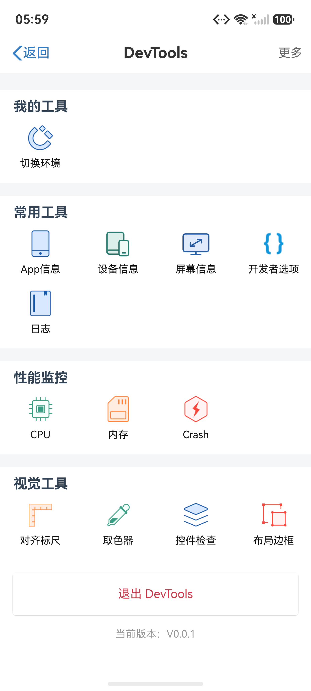
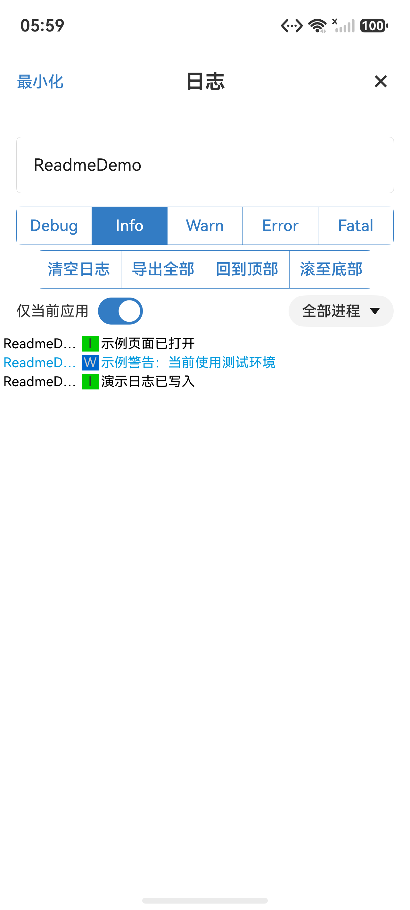

# HarmonyDevTools

在 HarmonyOS 应用里点悬浮锤子，可以查看日志、Crash、CPU、内存和设备信息，也可以用标尺、取色器和布局边框检查界面。支持 API 20 及以上的 Stage 应用。

<p>
  
  
  
</p>

## 接入

1. 在装有 DevEco Studio 和 HarmonyOS SDK 26 的 Windows 上，从本仓库根目录运行 `.\build-har.ps1`，把 `build/outputs/release/com.ttxz.devtools-0.0.1.har` 复制到应用的 `entry/libs/`。
2. 在 `entry/oh-package.json5` 的 `dependencies` 中加入 `"com.ttxz.devtools": "file:./libs/com.ttxz.devtools-0.0.1.har"`，然后在应用工程根目录运行 `ohpm install --all`。
3. 在应用根目录的 `build-profile.json5` 里，把目标 product 的 `buildOption.strictMode.useNormalizedOHMUrl` 设为 `true`。页面持有一个 `DevToolsController`，在全屏 `Stack` 最后一层挂载 `DevToolsOverlay({ controller: this.tools })`。[可直接运行的完整页面](./devtools/README.md#完整页面)

中心仓上架后，可在应用模块目录运行 `ohpm install com.ttxz.devtools` 代替前两步。

## 添加自己的工具

截图里的「我的工具 → 切换环境」是示例应用注册的按钮。用传给 `DevToolsOverlay` 的同一个控制器，在页面的 `aboutToAppear()` 中注册这个按钮。

```typescript
this.tools.register({
  id: 'demo.environment',
  title: '切换环境',
  group: '我的工具',
  onSelect: (): void => { this.chooseEnvironment(); }
});
```

`title` 是按钮名称，`group` 是分组。点击后工具箱先收起，再执行 `onSelect`。把 `chooseEnvironment()` 换成你自己的方法，就能打开业务页面或执行调试操作。

- **换图标**　把图片放入应用的 `entry/src/main/resources/base/media/`。例如 `ic_environment.svg` 对应 `icon: $r('app.media.ic_environment')`。省略 `icon` 会使用默认图标。
- **更新或移除**　相同 `id` 再次注册会替换原按钮。`register()` 返回注销函数，需要单独移除时调用它。页面销毁时调用 `tools.dispose()`。

<details>
<summary>维护者命令</summary>

```powershell
node --test "tests/devtools-*.test.cjs"
ohpm prepublish .\build\outputs\release\com.ttxz.devtools-0.0.1.har
```

构建脚本支持用 `-DevEcoHome` 指定 DevEco Studio 的安装目录。正式发布时，将同一份 HAR 交给 `ohpm publish`。[OHPM 发布说明](https://developer.huawei.com/consumer/cn/doc/harmonyOS-guides/ide-ohpm-publish/)

</details>

[Apache-2.0 许可证](./LICENSE) · [DoKit 图标来源](./devtools/src/main/resources/rawfile/devtools_artwork.txt) · [版本记录](./devtools/CHANGELOG.md)
