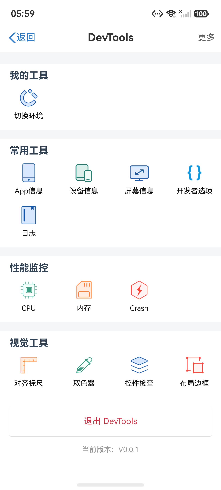
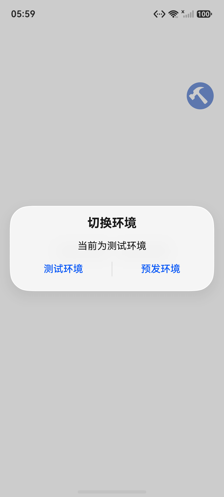
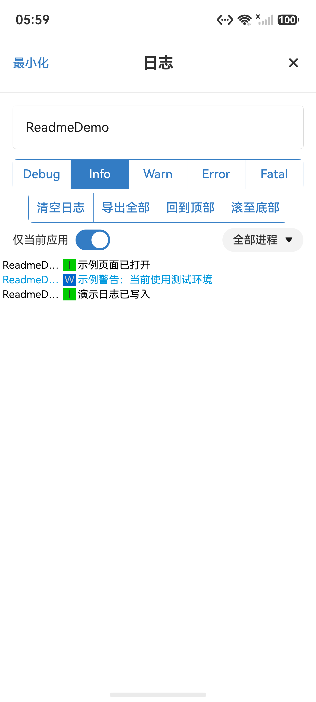

# HarmonyDevTools

HarmonyOS 应用内调试工具箱，支持 API 20 及以上的 Stage 应用。下图依次是工具箱、自定义按钮打开的环境选择框，以及筛选后的应用日志。

<p>
  
  
  
</p>

## 安装

中心仓上架后，在使用方模块目录执行 `ohpm install com.ttxz.devtools`。接入本地 HAR 时，把文件放到 `entry/libs/`，并将这项依赖合并到 `entry/oh-package.json5`。

```json5
{
  "dependencies": {
    "com.ttxz.devtools": "file:./libs/com.ttxz.devtools-0.0.1.har"
  }
}
```

在应用工程根目录执行 `ohpm install --all`，并将根 `build-profile.json5` 里目标 product 的 `buildOption.strictMode.useNormalizedOHMUrl` 设为 `true`。[获取和构建 HAR](https://github.com/DriveSpark/HarmonyDevTools#接入)

## 完整页面

把下面的代码放到一个入口页面。点锤子，选「我的工具 → 切换环境」，再点「预发环境」，就能看到页面上的环境名称改变。

```typescript
import { DevToolsController, DevToolsOverlay } from 'com.ttxz.devtools';

@Entry
@ComponentV2
struct Index {
  private readonly tools: DevToolsController = new DevToolsController();
  @Local environmentName: string = '测试环境';
  @Local foreground: boolean = true;

  aboutToAppear(): void {
    this.tools.register({
      id: 'demo.environment',
      title: '切换环境',
      group: '我的工具',
      onSelect: (): void => { this.chooseEnvironment(); }
    });
  }

  private chooseEnvironment(): void {
    this.getUIContext().showAlertDialog({
      title: '切换环境',
      message: `当前为${this.environmentName}`,
      primaryButton: { value: '测试环境', action: (): void => { this.environmentName = '测试环境'; } },
      secondaryButton: { value: '预发环境', action: (): void => { this.environmentName = '预发环境'; } }
    });
  }

  onPageShow(): void { this.foreground = true; }
  onPageHide(): void { this.foreground = false; }
  onBackPress(): boolean { return this.tools.handleBack(); }
  aboutToDisappear(): void { this.tools.dispose(); }

  build() {
    Stack() {
      Text(`当前环境：${this.environmentName}`).fontSize(20)
      DevToolsOverlay({ controller: this.tools, foreground: this.foreground, captureHiLog: true })
    }.width('100%').height('100%')
  }
}
```

### 换成自己的按钮

`id` 标识工具，`title` 决定名称，`group` 决定分组。`onSelect` 在工具箱收起后执行，已有环境选择页的应用可在这里打开自己的页面。

- 可选的 `icon` 接受资源引用。把 `ic_environment.svg` 放在应用模块的 `src/main/resources/base/media/` 后，给注册对象加上 `icon: $r('app.media.ic_environment')`。
- 相同 `id` 再次注册会替换按钮。临时工具可用 `const remove = this.tools.register(action)` 保存注销函数，在需要移除该工具时调用 `remove()`。
- 示例通过 `captureHiLog: true` 采集应用日志。只想在调试版显示时，可在宿主的调试构建条件内挂载 `DevToolsOverlay`。内置工具可在「更多 → 功能管理」中调整顺序和显隐。

[Apache-2.0 许可证](./LICENSE) · [DoKit 图标清单](./src/main/resources/rawfile/devtools_artwork.txt) · [上游许可证](./src/main/resources/rawfile/devtools_dokit_license.txt)
